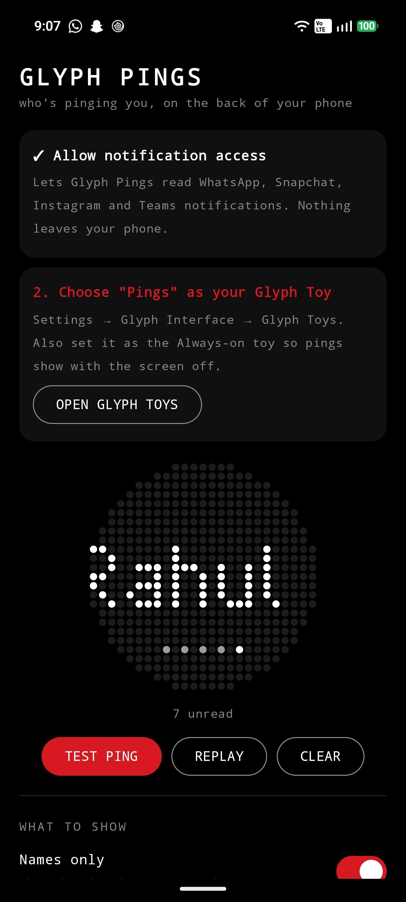
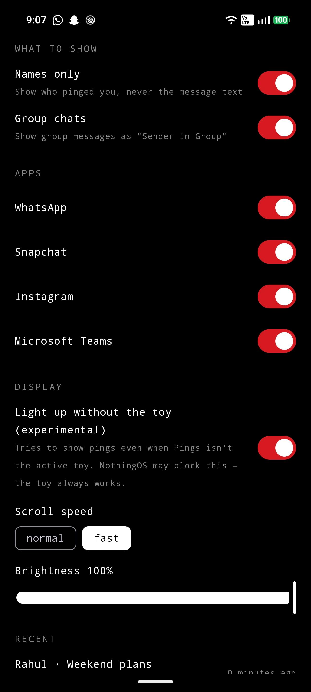

<div align="center">

# Glyph Pings

**See who's messaging you — on the back of your Nothing Phone (3).**

WhatsApp · Snapchat · Instagram · Microsoft Teams → app logo + scrolling sender name on the Glyph Matrix.


`No internet permission` · `Open source` · `Names-only by default` · `Free`

[**Download the latest APK**](../../releases/latest)

</div>

---

## Why
With the phone face-down on your desk you can't see the screen, so the Glyph Matrix becomes the display. Glyph Pings tells you **who** is pinging you, so you know whether it's worth picking up the phone.

## What it does
- 🔔 **The app's logo pops up**, taken from the app's own notification icon.
- 🔤 **The sender's name scrolls across the matrix** in a hand-made pixel font, like NothingOS caller ID.
- 👥 **Group chats** show as *"Rahul in Weekend plans"*. You can turn groups off.
- 💬 **Message text (optional).** **Names only** is on by default, so nothing private shows on the back of your phone.
- ⚫ **Unread dots** stay lit until you read or dismiss the notification.
- 🔘 **Glyph Button controls:**
  - **Long-press** to replay the latest ping.
  - **Hold for 1.5 seconds** to mark everything as read.
- 🌙 **Works as an Always-on (AOD) toy**, so pings show while the screen is off.

## Screenshots
<p align="center">
  
  &nbsp;&nbsp;
  
</p>

## Install
1. Download `GlyphPings-x.y.apk` from [Releases](../../releases/latest) and install it.
2. Open the app → **Open settings** → allow **Glyph Pings** notification access.
   > If Android says **"Restricted setting"**, go to App info → ⋮ → **Allow restricted settings**, then try again. Android does this for every app installed from outside the Play Store.
3. Tap **Open Glyph Toys**, turn on **Pings**, and also choose it as your **Always-on toy**.
4. Tap **Test ping**. 🎉

**Requires:** Nothing Phone (3), NothingOS build 20250801 or newer.

## Privacy
Glyph Pings reads notifications, so you should know exactly what it does:
- **There's no `INTERNET` permission** in [`AndroidManifest.xml`](app/src/main/AndroidManifest.xml). The app physically can't send your messages anywhere.
- **It only looks at the four apps you enable.** Everything else is ignored, in [`ping/Sources.kt`](app/src/main/java/com/glyphpings/ping/Sources.kt).
- **Nothing is stored.** Recent pings are kept in memory only, until the app is closed.
- **Names only** is the default.

## Known limits
- **Snapchat:** a snap's photo or video is never included in the notification, so you see who sent it, not the snap.
- **Teams:** Teams often doesn't notify your phone while you're active on your computer.
- **Non-Latin names** (Tamil, Hindi, Arabic and others) use a tiny fallback font. They're readable, but less crisp than the Latin pixel font.
- **"Light up without the toy"** is experimental. NothingOS may only show pings when **Pings** is the active toy or AOD toy.

## Build from source
The Nothing Glyph Matrix SDK is closed-source, so it isn't included in this repo.
1. Download `glyph-matrix-sdk-*.aar` from Nothing's [GlyphMatrix-Developer-Kit](https://github.com/Nothing-Developer-Programme/GlyphMatrix-Developer-Kit) and put it in `app/libs/`.
2. Open the project in Android Studio. Set the Gradle JDK to **17 or 21**, not 25, then press ▶ Run.

```
Notification ─► PingListenerService ─► PingParser (sender, group, text, app icon)
                                         │  skips summaries, "checking for new messages", calls, duplicates
                                         ▼
                                    PingCenter (queue + unread)
                                         │  PingRenderer: logo pop → pixel-font scroll → idle + dots
                              ┌──────────┴──────────┐
                      Pings Glyph Toy        in-app preview
```

**To add another app**, add a line to `ping/Sources.kt` and add its package to `<queries>` in the manifest. PRs are welcome!

## Roadmap / ideas
- [ ] Per-contact VIP list (show the message text only for chosen people)
- [ ] Quiet hours
- [ ] Telegram, Signal, Gmail and Slack
- [ ] Contact-photo mode (the sender's avatar, dithered to 25×25)

## License
The code in this repo is under the [MIT License](LICENSE). The Nothing Glyph Matrix SDK has its own proprietary licence and isn't covered by this repo's license.

*Unofficial community project. Not affiliated with or endorsed by Nothing Technology, WhatsApp, Meta, Snap Inc. or Microsoft. App icons shown on the matrix come from each app's own notification at runtime.*
